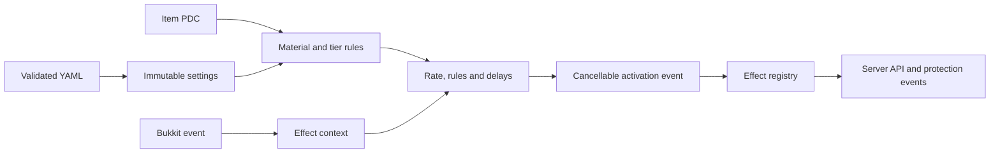

# Architecture

CustomEnchants is an original Bukkit plugin by Lino using Java 21 bytecode and the Spigot 1.21.11 API baseline. Bukkit is provided by the server; the distribution does not bundle it. Gameplay uses Bukkit APIs, with one isolated reflective compatibility adapter described below and no native compile-time dependency.

## Flow

`ConfigurationLoader` validates references and creates an immutable snapshot. The active snapshot is replaced only after all files load successfully. `ItemData` owns namespaced item identity, enchantment tiers, tome rates, soul reserves, counters and generated lore. Lore is a view of metadata rather than its source of truth.

`EnchantService` enforces slot, incompatibility, material and prerequisite rules. `EnchantEngine` selects the highest equipped tier for a given enchantment and routes it through rule conditions, activation rate, delays and a cancellable event. Death retention evaluates each item independently.

`EffectRegistry` dispatches focused damage, entity, item, world and utility operations using the pipe-and-arrow DSL (`operation | arg1 | arg2 -> scope[key=val]`). `TargetSelector` validates selector syntax and parameters; `TargetResolver` returns typed entity/location results, with `BlockTargets` handling block geometry (`cube_area`, `tunnel_area`, `vein_area`). `TemplateFunctions` (`[func:body]`), `Variables` (`{domain.property}`), `BooleanExpression` and the decimal `Expression` parser keep text expansion, variable lookup, conditions (`expr => outcome`) and arithmetic separate. Delayed work snapshots event values and does not retain a live event for later mutation. Total delay, pending work, target counts, area sizes and temporary entities are bounded.

`VisualEffects` handles firework metadata and bounded particle-beam sampling for entity and location targets. `SpawnService` centralizes transient ownership, projectile/potion/combustion protection, generic spawning, falling-block landings and explosions. Generic spawns keep natural persistence; generated attacks have bounded lifetimes.

`GuardService` separates protected ownership, enemy and responsible player, supports living entity types and owns conversion/expiry state.

`GameplayListener` translates combat, mining, fishing, death and equipment events into CustomEnchants event triggers (`MELEE_HIT`, `BLOCK_BREAK`, `ARMOR_PASSIVE`, etc.). `BlockService` queues additional blocks with their material filters, then uses the completed activation's drop settings while asking the normal server to break them. Nested breaks dispatch protection events but do not activate enchantments recursively. Cancellation discards pending terrain changes. `InventoryListener` handles tomes, anvils, grindstones and the enchanting table. `MenuService` keeps virtual items inside protected GUI inventories and validates the selected inventory contents again before a workstation exchange.

`EquipmentService` builds sets, weapons and loadout kits. `EnchantEngine` reconciles permanent activations (`ARMOR_PASSIVE`, `HAND_PASSIVE`) and executes equip/unequip actions once; generation tokens discard delayed callbacks for ended activations. `PassiveService` aggregates flight and fluid-walking requests. `EntityStateService` owns scoped potion/speed/invulnerability leases, item-use locks, movement flags, armor snapshots and bleeding sequences. Its single tick task expires temporary state and restores contributions without per-effect repeating tasks.

`EconomyService` isolates optional Vault calls and attempts a refund when the recipient rejects a transfer. `PermissionService` isolates persistent LuckPerms/Vault permission changes. `SkillIntegrationService` caches public API bindings per provider instance for mcMMO.

`HealthService` applies direct-health operations (`reduce_health`, `damage_health`, `reduce_health_totem`, `damage_health_totem`) through attributed damage events, preserving cancellation, absorption and death handling. `HurtCooldown` caches capability lookup per entity class to support Minecraft 26.x's separate `damageCooldownTime` counter while falling back to standard Bukkit methods on 1.21.11.

## API

Other plugins can depend on CustomEnchants and obtain the JavaPlugin instance through Bukkit's plugin manager. Public events are `EnchantApplyEvent`, `EnchantActivateEvent` and `EnchantAffectEvent`; all are synchronous and cancellable. Their item getters return defensive copies.

`plugin.enchants()` provides definition lookup, tome creation, rule checks, application and removal. `plugin.items()` exposes persistent item data. Invoke these services on the server thread.
